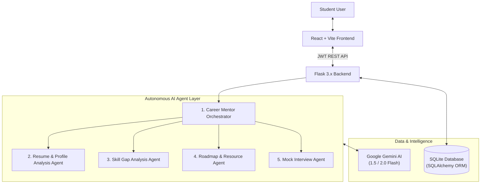

# AI Career Mentor Agent

An intelligent, multi-agent AI-powered career mentoring platform designed to guide students and early-career professionals through personalized career planning, ATS resume diagnostics, skill gap analysis, personalized roadmaps, and voice-assisted simulated mock interviews.

---

## Academic Project Information

| Field | Details |
|---|---|
| **Course** | **Bachelor of Computer Applications (BCA)** |
| **Institution** | **Birla Institute of Technology, Mesra** (BIT Mesra) |
| **Project Status** | **Completed & Fully Functional** |
| **Academic Batch** | 2024 – 2027 |

### Project Team Members

| Name | Roll Number | Role |
|---|---|---|
| **Riya Rani** | `BCA/40009/24` | Core AI Agent Pipelines & Prompt Engineering |
| **Shambhavi Shrivastava** | `BCA/40010/24` | Backend Services, Database Architecture & API Integration |
| **Divyanka Singh** | `BCA/40026/24` | Full-Stack Integration, Speech Suite & UI/UX Design |
| **Puja Sharma** | `BCA/40031/24` | Resume ATS Diagnostics, Roadmap Engine & Testing |

---

## Project Overview & Key Features

The **AI Career Mentor Agent** addresses the critical gap between academic curriculum and current tech industry requirements by providing students with an end-to-end, autonomous career accelerator:

1. **3 Guided Onboarding Pathways**:
   - **Path 1 (Target Role Decided)**: Direct transition into gap analysis, tailored roadmap, and role-specific interview preparation.
   - **Path 2 (A Few Roles in Mind)**: Comparative fit analysis across 2–4 candidate roles with real-time career match percentages.
   - **Path 3 (Role Not Decided Yet)**: AI-driven discovery recommending optimal career tracks based on background, interests, and aspirations.
2. **Resume Analysis & ATS Scoring Engine**:
   - In-depth text extraction from PDF and DOCX documents with validation guards against invalid file types.
   - Objective ATS compatibility score (0–100), key strengths breakdown, identified missing areas, and actionable improvement diagnostics.
   - **"Improve My Resume" AI Draft Generator** with instant formatted markdown preview and dynamic downloadable PDF output.
3. **Skill Gap Analysis**:
   - Compares the student's existing skills against real-world benchmark requirements for their target role.
   - Categorizes capabilities into *Existing*, *Weak*, and *Missing* skills.
4. **Personalized Learning Roadmap & Milestones**:
   - Progressive phase-by-phase learning path customized for the user's target role and company.
   - Curated high-impact learning resources, hands-on practice projects, and industry certifications.
   - Interactive milestone completion tracking with real-time percentage updates.
5. **Simulated AI Mock Interview Suite**:
   - Adaptive technical and behavioral interview sessions powered by Google Gemini AI.
   - Live camera stream integration and Web Speech API / browser voice synthesis & speech recognition.
   - Question-by-question scoring (0–100) with detailed constructive feedback on correctness, clarity, and depth.
6. **24/7 Context-Aware AI Career Mentor**:
   - Real-time conversational AI mentor drawer backed by chat history persistence.
   - Tailored mentoring considering the student's current profile, target role, and roadmap milestones.
7. **Progress Analytics Dashboard**:
   - Unified analytics covering overall career readiness score, milestone completion, interview metrics, and ATS resume health.
8. **Secure Authentication & Data Isolation**:
   - JWT-based authentication with PBKDF2 password hashing.
   - Isolated student workspaces and persistent SQLite database with SQLAlchemy ORM.

---

## Multi-Agent Architecture

The system coordinates five specialized AI agents coordinated by an Orchestrator:



1. **Career Mentor Orchestrator Agent**: Manages end-to-end task routing, agent chaining, and multi-agent coordination.
2. **Resume and Profile Analysis Agent**: Validates resume structure, computes ATS scoring, extracts structured profiles, and generates improved drafts.
3. **Skill Gap Analysis Agent**: Evaluates proficiencies against market expectations and computes role compatibility scores.
4. **Learning and Career Roadmap Agent**: Generates sequenced milestone learning plans, practical projects, and certified resources.
5. **Mock Interview Agent**: Generates tailored interview questions, transcribes answers, and delivers objective scoring with actionable critique.

---

## Technology Stack

| Layer | Technology | Details |
|---|---|---|
| **Frontend** | React 18, Vite 5, JavaScript (ES2023) | Responsive single-page application with modern glassmorphism styling |
| **Backend** | Python 3.11+ / 3.12+, Flask 3.x | Modular REST API with Blueprints, Services, and Agent wrappers |
| **AI / LLM** | Google Gemini 1.5 / 2.0 Flash, LangChain architecture | Context-aware reasoning, resume generation, and interview scoring |
| **Database** | SQLite + SQLAlchemy ORM | Strictly isolated relational schemas with foreign key constraints |
| **Authentication** | JWT (PyJWT) + Werkzeug Security | Secure token-based authentication and salted password hashing |
| **Document Processing** | PyPDF, python-docx, ReportLab | Native PDF/DOCX parsing and automated ATS resume PDF compilation |
| **Speech & Media** | Web Speech API, WebRTC MediaStream | Real-time speech-to-text, voice synthesis, and video stream |
| **Testing** | Pytest, pytest-flask | Comprehensive unit, role transition, and security audit test suite |

---

## Project Structure

```
AI-Career-Mentor-Agent/
├── backend/                  # Flask REST API & AI agents
│   ├── app/
│   │   ├── agents/           # 5 Specialized AI agents + Orchestrator
│   │   ├── api/v1/           # REST endpoints (auth, resume, skills, roadmap, interview, etc.)
│   │   ├── config/           # Application configuration & environments
│   │   ├── models/           # SQLAlchemy database entity models
│   │   ├── services/         # Business logic (LLM service, resume, progress, auth)
│   │   └── utils/            # JWT decorators, validators, PDF helpers
│   ├── tests/                # Automated Pytest suite
│   ├── .env.example          # Template for environment variables
│   ├── requirements.txt      # Python dependencies
│   ├── reset_db.py           # Database wipe and schema rebuild utility
│   └── run.py                # Flask entry point
├── frontend/                 # React 18 + Vite frontend
│   ├── src/
│   │   ├── components/       # UI views, dashboards, modals, drawers
│   │   ├── services/         # Axios/Fetch API client wrapper
│   │   ├── styles/           # Modern glassmorphism CSS design system
│   │   ├── App.jsx           # Master application container & routing
│   │   └── main.jsx          # React DOM entry point
│   ├── package.json          # Frontend dependencies & npm scripts
│   └── vite.config.js        # Vite bundler configuration
├── docs/                     # Academic documentation & diagrams
│   ├── api/                  # Comprehensive REST API reference
│   ├── architecture/         # Workflow, multi-agent & system architecture
│   ├── database/             # Relational database schema & ER specifications
│   └── report/               # Academic Project Report (BIT Mesra BCA)
├── data/                     # Career datasets, roles benchmark & samples
├── scripts/                  # Project automation & verification scripts
└── README.md                 # Project documentation
```

---

## Implementation Status

- [x] Project repository initialized and configured
- [x] Folder structure established for frontend, backend, docs, data, and scripts
- [x] Frontend React + Vite application setup with glassmorphism UI
- [x] Backend Flask application setup with modular blueprints
- [x] React–Flask API integration verified
- [x] Database implementation (SQLite + SQLAlchemy ORM with foreign keys)
- [x] Authentication (JWT + Password Hashing + Session Isolation + Password Reset)
- [x] AI agent implementation (Orchestrator, Resume Analysis, Skill Gap, Roadmap, Mock Interview)
- [x] Resume Analysis, ATS Compatibility Score & Diagnostics
- [x] "Improve My Resume" AI Draft Generator & Instant PDF Downloader
- [x] 3-Path Career Onboarding Flow & Real Role Matching Engine
- [x] Personalized Learning Roadmap, Milestone Tracking & Projects
- [x] Interactive AI Mock Interview Suite (WebRTC Camera + Live Voice Speech API)
- [x] Progress Analytics Dashboard & Activity Persistence
- [x] 24/7 Context-Aware AI Mentor Chat Drawer with History Persistence
- [x] Comprehensive Academic Project Report and Architecture Documentation
- [x] Backend Pytest suite (13/13 passing tests)
- [x] Production frontend build verified

---

## Getting Started

### Prerequisites
- **Node.js** (v18.x or higher) and `npm`
- **Python** (v3.11 or v3.12) and `pip`
- (Optional) **Google Gemini API Key** for live LLM responses (fallback rule-based agents operate seamlessly if no key is provided)

---

### Step 1: Set Up Backend

1. Navigate to the backend directory:
   ```bash
   cd backend
   ```

2. (Recommended) Create and activate a virtual environment:
   ```bash
   python -m venv venv
   # Windows:
   venv\Scripts\activate
   # macOS/Linux:
   source venv/bin/activate
   ```

3. Install backend dependencies:
   ```bash
   pip install -r requirements.txt
   ```

4. Create environment configuration:
   ```bash
   cp .env.example .env
   ```
   Add your `GEMINI_API_KEY` in `.env` if you wish to use live Gemini AI inference.

5. Initialize the database:
   ```bash
   python reset_db.py
   ```

6. Start the Flask server:
   ```bash
   python run.py
   ```
   The backend will be available at: **`http://127.0.0.1:5000`**  
   Health check: **`http://127.0.0.1:5000/api/v1/health`**

---

### Step 2: Set Up Frontend

1. Open a new terminal and navigate to the frontend directory:
   ```bash
   cd frontend
   ```

2. Install dependencies:
   ```bash
   npm install
   ```

3. Start the development server:
   ```bash
   npm run dev
   ```
   The application will launch at: **`http://localhost:5173`** (or `http://localhost:5174`).

---

### Step 3: Run Tests & Verification

1. Run backend unit and integration tests:
   ```bash
   cd backend
   python -m pytest
   ```

2. Verify frontend production build:
   ```bash
   cd frontend
   npm run build
   ```

---

## Documentation Links

- [Academic Project Report](docs/report/project-report.md)
- [REST API Reference](docs/api/api-reference.md)
- [System Architecture](docs/architecture/system-architecture.md)
- [Application Workflow](docs/architecture/application-workflow.md)
- [Multi-Agent Architecture](docs/architecture/multi-agent-architecture.md)
- [Database Schema Design](docs/database/database-design.md)

---

## Acknowledgments

Developed as the Final Year Project for **Bachelor of Computer Applications (BCA)** at **Birla Institute of Technology, Mesra (BIT Mesra)** under the Department of Computer Science & Engineering / Computer Applications.
