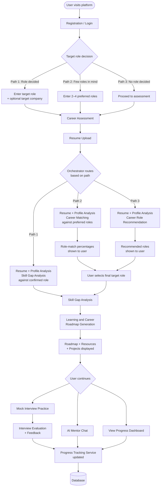
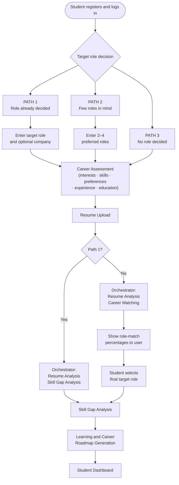
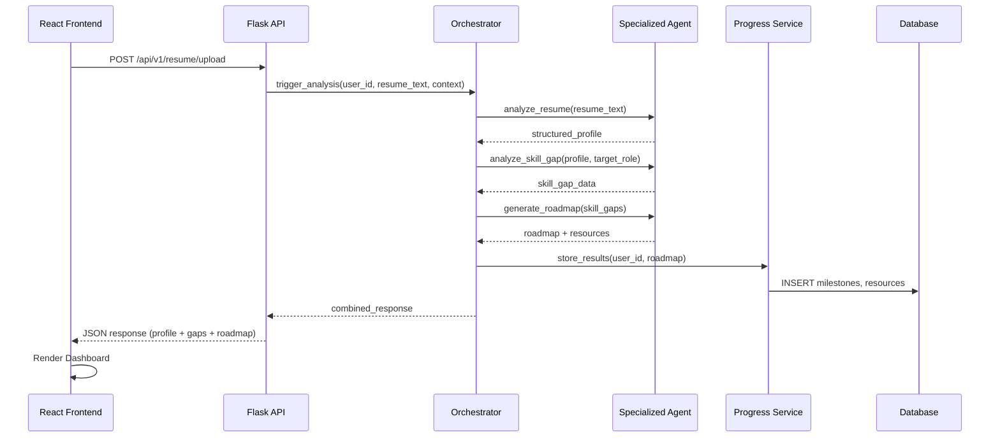
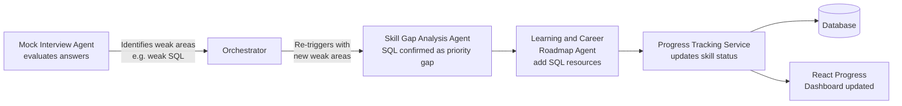

# Application Workflow — AI Career Mentor Agent

## Academic Project Details
- **Course**: Bachelor of Computer Applications (BCA)
- **Institution**: Birla Institute of Technology, Mesra (BIT Mesra)
- **Project Team**:
  - Riya Rani [BCA/40009/24]
  - Shambhavi Shrivastava [BCA/40010/24]
  - Divyanka Singh [BCA/40026/24]
  - Puja Sharma [BCA/40031/24]
- **Status**: Completed & Production Ready

---

## 1. Overview

This document describes the complete end-to-end user journey through the AI Career Mentor Agent, from first visit through to ongoing career development.

The workflow has three phases:
1. **Onboarding** — registration, career assessment, resume upload, target role selection
2. **Core Career Analysis** — profile analysis, skill gap analysis, roadmap generation
3. **Ongoing Development** — mock interviews, progress tracking, AI mentor chat

---

## 2. Complete User Workflow



---

## 3. Three Onboarding Paths

### Path 1 — Target Role Already Decided

The student knows their target role before starting.

**Steps:**
1. Register / log in
2. Answer: *"Have you decided your target role?"* → **Yes**
3. Enter target role (required) and target company (optional)
4. Complete career assessment (interests, skills, preferences, experience)
5. Upload resume
6. System runs: Resume Analysis → Skill Gap Analysis (against confirmed role)
7. Proceed directly to roadmap generation

**Advantage:** Fastest path. No role matching step required.

---

### Path 2 — Student Has a Few Preferred Roles

The student has ideas but is not yet committed to one role.

**Steps:**
1. Register / log in
2. Answer: *"I have some roles in mind but I am not sure"*
3. Enter 2–4 preferred roles (e.g., Software Developer, Data Analyst, AI/ML Engineer, Cybersecurity Analyst)
4. Complete career assessment
5. Upload resume
6. System analyses: resume, skills, interests, assessment, education, projects, experience
7. System displays estimated career-match percentages:

```
Data Analyst       — 89%
Software Developer — 84%
AI/ML Engineer     — 76%
Cybersecurity      — 68%
```

8. Student selects one final target role
9. Proceed to skill gap analysis against chosen role

---

### Path 3 — No Target Role Decided

The student has no specific role in mind.

**Steps:**
1. Register / log in
2. Answer: *"I have not decided my target role yet"*
3. Complete career assessment
4. Upload resume
5. System analyses everything and recommends suitable career roles with match percentages:

```
Software Developer — 91%
Data Analyst       — 86%
AI/ML Engineer     — 79%
```

6. Student selects one final target role
7. Proceed to skill gap analysis against chosen role

---

## 4. Three-Path Onboarding Diagram



---

## 5. Common Workflow After Target Role Is Confirmed

Once the student has a confirmed target role (from any path), the same sequence runs:

| Step | Component | Output |
|------|-----------|--------|
| 1 | Resume and Profile Analysis Agent | Structured profile, resume score, strengths, missing areas |
| 2 | Skill Gap Analysis Agent | Existing skills, weak skills, missing skills, priority gaps |
| 3 | Learning and Career Roadmap Agent | Personalized roadmap, milestones, courses, projects, certifications |
| 4 | Progress Tracking Service | Roadmap stored, milestones initialized at 0% |
| 5 | Mock Interview Agent | Role-specific questions, answer evaluation, performance score |
| 6 | Progress Tracking Service | Interview score stored, skill feedback recorded |
| 7 | AI Mentor Chat | Conversational career guidance through Orchestrator |
| 8 | Progress Dashboard | Overall progress, milestones, skill status, interview history |

---

## 6. Flask API → React Data Flow



---

## 7. Mock Interview Feedback Loop



This loop allows mock interview performance to continuously refine the student's learning roadmap — the platform adapts as the student grows.
