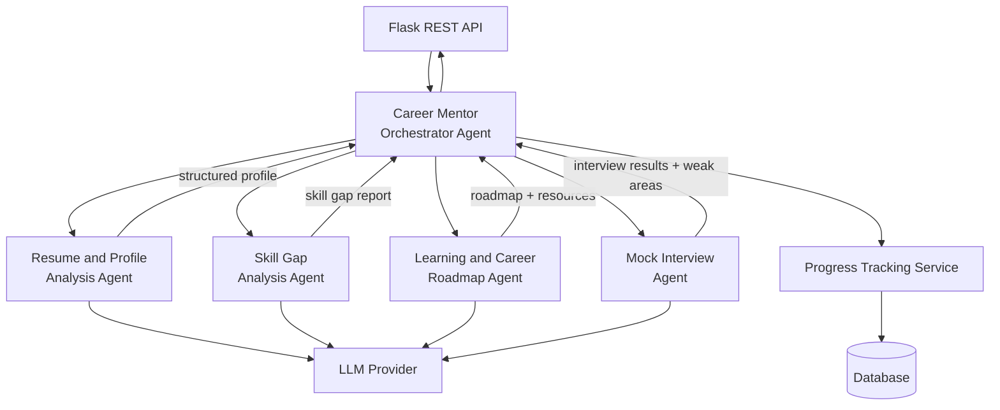

# Multi-Agent Architecture — AI Career Mentor Agent

## Academic Project Details
- **Course**: Bachelor of Computer Applications (BCA)
- **Institution**: Birla Institute of Technology, Mesra (BIT Mesra)
- **Project Team**:
  - Riya Rani [BCA/40009/24]
  - Shambhavi Shrivastava [BCA/40010/24]
  - Divyanka Singh [BCA/40026/24]
  - Puja Sharma [BCA/40031/24]
- **Status**: Completed & Production Ready

---

## 1. Overview

This document defines the five AI agents used in the system, their individual responsibilities, their inputs and outputs, and how they are coordinated by the Career Mentor Orchestrator.

**Key design principle:** Each agent does exactly one thing. The Orchestrator handles everything else.

---

## 2. Agent Summary

| # | Agent | Type | LLM Required |
|---|-------|------|-------------|
| 1 | Career Mentor Orchestrator | Coordination agent | Yes |
| 2 | Resume and Profile Analysis Agent | Extraction agent | Yes |
| 3 | Skill Gap Analysis Agent | Analysis agent | Yes |
| 4 | Learning and Career Roadmap Agent | Generation agent | Yes |
| 5 | Mock Interview Agent | Conversational agent | Yes |

---

## 3. Agent 1 — Career Mentor Orchestrator

### Role
The central coordinator. The only agent the Flask API speaks to directly.

### Responsibilities
- Receive the task request from the Flask API
- Read and maintain the user's current context (target role, profile summary, prior agent results)
- Decide which specialized agent(s) to invoke for the current task
- Pass the minimum necessary information to each agent
- Chain agents when multi-step workflows are required
- Aggregate results from multiple agents into one coherent response
- Forward structured results to the Progress Tracking Service
- Return the final response to the Flask API

### What it does NOT do
- It does not analyze resumes
- It does not generate roadmaps
- It does not run interviews
- It does not access the database directly

### Why this design?
Centralizing coordination means specialized agents remain simple. They receive exactly what they need and return a structured result. The Orchestrator holds all user context; agents are stateless.

---

## 4. Agent 2 — Resume and Profile Analysis Agent

### Role
Parse and understand the student's resume and career assessment profile.

### Inputs
- Raw resume text (extracted from uploaded PDF/DOCX by the Resume Service)
- Career assessment responses
- Education details
- Any additional profile information the student provided

### Responsibilities
- Extract education (degrees, institutions, graduation year)
- Extract technical skills
- Extract soft skills
- Extract work experience and internships
- Extract projects (title, technologies used, description)
- Extract certifications and courses
- Identify notable strengths
- Identify gaps or missing information (e.g., no GitHub link, no quantified achievements)
- Generate a resume score (0–100)
- Produce a structured JSON profile for the Orchestrator

### Outputs (structured)
```json
{
  "resume_score": 74,
  "education": [...],
  "skills": [...],
  "experience": [...],
  "projects": [...],
  "certifications": [...],
  "strengths": [...],
  "missing_areas": [...],
  "profile_summary": "..."
}
```

### What it does NOT do
- It does not compare skills to a target role
- It does not identify skill gaps (that is the Skill Gap Analysis Agent's job)
- It does not generate a roadmap

---

## 5. Agent 3 — Skill Gap Analysis Agent

### Role
Compare the student's current capabilities against the requirements of the selected target role and produce a structured gap analysis.

### Inputs (from Orchestrator)
- Structured profile from the Resume and Profile Analysis Agent
- Final confirmed target role (e.g., "Data Analyst")
- Optional target company (e.g., "Google")
- Career assessment responses
- Education and project details

### Responsibilities
- Identify the key skills required for the target role
- Map the student's existing skills against requirements
- Classify skills as: **existing** (strong), **weak** (partially known), or **missing**
- Prioritize gaps by importance to the role
- Note if target company context changes the priority order
- Produce a structured skill-gap report

### Outputs (structured)
```json
{
  "target_role": "Data Analyst",
  "existing_skills": [...],
  "weak_skills": [...],
  "missing_skills": [...],
  "priority_gaps": [...],
  "gap_summary": "..."
}
```

### What it does NOT do
- It does not generate a roadmap
- It does not recommend learning resources
- It does not run interviews

---

## 6. Agent 4 — Learning and Career Roadmap Agent

### Role
Transform the skill gap analysis into a personalized, actionable career roadmap with learning resources, project recommendations, and career-development milestones.

### Why roadmap and learning resources are combined
The roadmap is built from skill gaps, and learning resources fill those gaps. Generating them separately would require duplicating the context and produces less coherent results. Combining them in one agent gives a naturally integrated output.

### Inputs (from Orchestrator)
- Skill gap report from the Skill Gap Analysis Agent
- Student profile summary
- Target role and (optional) target company
- Student's existing skills and education level

### Responsibilities
- Convert priority skill gaps into a structured learning plan
- Organize the plan into milestones (e.g., Foundation, Intermediate, Advanced)
- Recommend specific courses, tutorials, or documentation for each skill gap
- Recommend practice projects to demonstrate skills
- Suggest relevant certifications where applicable
- Provide career-development guidance (portfolio, LinkedIn, GitHub, networking)
- Estimate rough timeframes for each milestone

### Outputs (structured)
```json
{
  "roadmap_title": "Data Analyst Roadmap — 6 months",
  "milestones": [
    {
      "id": 1,
      "title": "Foundation",
      "skills": ["SQL", "Excel"],
      "resources": [...],
      "projects": [...],
      "estimated_weeks": 4
    },
    ...
  ],
  "certifications": [...],
  "career_tips": [...]
}
```

---

## 7. Agent 5 — Mock Interview Agent

### Role
Conduct realistic mock interview sessions, evaluate student responses, provide detailed feedback, and produce a performance report.

### Inputs (from Orchestrator)
- Target role
- Student profile summary (skills, experience)
- Optional: specific weak areas to focus on (from previous interview results or skill gap analysis)

### Responsibilities
- Generate role-specific interview questions (technical and behavioural)
- Conduct the interview turn by turn (one question at a time)
- Evaluate each student answer for accuracy, depth, and clarity
- Provide per-answer feedback
- Summarize overall performance with a score
- Identify specific weak areas revealed during the interview
- Send weak areas back to the Orchestrator (which can trigger a feedback loop with the Skill Gap Agent)

### Outputs (structured)
```json
{
  "session_id": "...",
  "role": "Data Analyst",
  "score": 76,
  "questions": [...],
  "answers": [...],
  "feedback": [...],
  "weak_areas_identified": ["SQL window functions", "pandas groupby"],
  "overall_feedback": "..."
}
```

### Feedback Loop Integration
When `weak_areas_identified` is non-empty, the Orchestrator can optionally re-invoke the Skill Gap Analysis Agent and the Learning and Career Roadmap Agent to update the student's learning priorities based on actual interview performance.

---

## 8. Progress Tracking Service (Not an AI Agent)

### Role
A plain Flask backend service that records all structured results from AI agents and exposes them to the React frontend via REST API endpoints.

### Why not an AI agent?
Progress Tracking is record-keeping — storing numbers, percentages, and milestone statuses. It requires no language understanding or generation. A standard service is faster, cheaper, and more reliable.

### What it tracks
- Overall career-development progress percentage
- Roadmap completion (milestones started / completed)
- Skills completed vs. skills remaining
- Skill gap status (gap → in-progress → completed)
- Learning resources completed
- Projects completed
- Mock interview scores over time
- Interview performance history
- Career readiness indicators
- Recent activity log

### Sources of Progress Events

| Event Source | What is recorded |
|-------------|-----------------|
| Learning and Career Roadmap Agent (via Orchestrator) | Roadmap milestones created |
| Student action (via Flask API) | Milestone or resource marked as completed |
| Mock Interview Agent (via Orchestrator) | Interview score and weak areas stored |
| Skill Gap Analysis Agent (via Orchestrator) | Skill status updated after re-analysis |

### REST API Endpoints (planned)

| Method | Path | Purpose |
|--------|------|---------|
| GET | `/api/v1/progress/{user_id}` | Full progress summary |
| GET | `/api/v1/progress/{user_id}/roadmap` | Roadmap milestone status |
| PATCH | `/api/v1/progress/{user_id}/milestones/{id}` | Mark milestone complete |
| GET | `/api/v1/progress/{user_id}/interviews` | Interview score history |

---

## 9. Agent Layer Architecture Diagram


