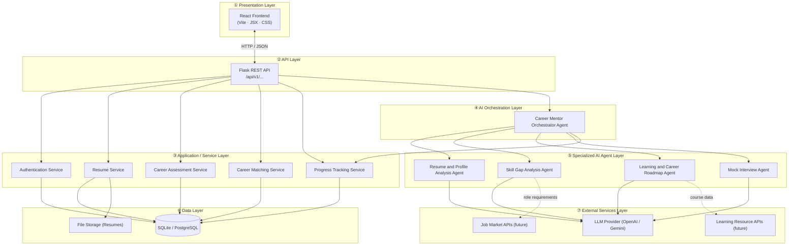

# System Architecture — AI Career Mentor Agent

## Academic Project Details
- **Course**: Bachelor of Computer Applications (BCA)
- **Institution**: Birla Institute of Technology, Mesra (BIT Mesra)
- **Project Team**:
  - Riya Rani [BCA/40009/24]
  - Shambhavi Shrivastava [BCA/40010/24]
  - Divyanka Singh [BCA/40026/24]
  - Puja Sharma [BCA/40031/24]
- **Status**: Completed & Production Ready

---

## 1. Overview

The AI Career Mentor Agent is a multi-layer web application that connects a React frontend to a Flask REST API backend, which coordinates a small team of specialized AI agents through a central Orchestrator.

The architecture is deliberately layered so that each layer has a single, clear responsibility. A student or developer can understand, modify, or replace any one layer without disrupting the others.

---

## 2. High-Level Layer Diagram

---

## 3. Layer Responsibilities

### ① Presentation Layer — React Frontend

| Item | Detail |
|------|--------|
| Technology | React 18, Vite 5, JavaScript, CSS |
| Responsibility | Render UI, capture user input, display AI results |
| Communication | All calls go through `src/services/api.js` using `fetch` |
| State | Managed with React hooks (`useState`, `useEffect`) |

The frontend never calls AI agents or the database directly. Every request goes through the Flask API.

---

### ② API Layer — Flask REST API

| Item | Detail |
|------|--------|
| Technology | Python, Flask 3, flask-cors |
| Responsibility | Accept requests, validate input, route to the correct service or Orchestrator |
| URL convention | `/api/v1/<resource>` |
| Current live endpoint | `GET /api/v1/health` |

The API layer is intentionally thin. It does not contain business logic — that lives in the Service or Agent layers.

---

### ③ Application / Service Layer

Five plain Python backend services, each with a single concern:

| Service | Responsibility |
|---------|---------------|
| **Authentication Service** | User registration, login, JWT token management |
| **Resume Service** | File upload, storage, retrieval, text extraction |
| **Career Assessment Service** | Store and retrieve structured assessment responses |
| **Career Matching Service** | Compute role-match percentages from profile and assessment data |
| **Progress Tracking Service** | Record and expose all user progress; receives events from AI agents |

No AI calls occur in any service. These are standard Flask/Python modules.

---

### ④ AI Orchestration Layer — Career Mentor Orchestrator

The Orchestrator is the **only entry point into the AI agent layer**.

Responsibilities:
- Understand the user's current task from the API request
- Maintain user session context (target role, profile summary, prior agent results)
- Invoke the correct specialized agent(s)
- Chain agents when multiple steps are needed (e.g., Resume → Skill Gap → Roadmap)
- Combine agent outputs into a single coherent response
- Forward structured results to the Progress Tracking Service

> **Why a single Orchestrator?**
> Centralizing coordination keeps each agent focused on one task. The Orchestrator is the only component that holds the full user context. Agents receive only the specific inputs they need.

---

### ⑤ Specialized AI Agent Layer

Four agents, each with one core responsibility:

| Agent | Core Task |
|-------|-----------|
| Resume and Profile Analysis Agent | Parse the resume → structured profile data |
| Skill Gap Analysis Agent | Current skills vs. target role requirements → prioritized gap list |
| Learning and Career Roadmap Agent | Gaps → roadmap, learning resources, project recommendations |
| Mock Interview Agent | Generate questions → evaluate answers → performance feedback |

All agents share a single **LLM abstraction utility** so the provider (OpenAI, Gemini, local model) can be changed in one place without touching agent code.

---

### ⑥ Data Layer

| Component | Purpose |
|-----------|---------|
| **Relational Database** | All structured data: users, profiles, assessments, roadmaps, progress, interviews |
| **File Storage** | Uploaded resume files (PDF / DOCX) |

The database is accessed only by the Service Layer. Agents never touch the database directly.

---

### ⑦ External Services Layer (Future / Planned)

| Service | Purpose | Status |
|---------|---------|--------|
| LLM Provider | Powers all four AI agents | Planned (OpenAI / Gemini) |
| Job Market APIs | Provide real-world role skill requirements | Future |
| Learning Resource APIs | Supplement roadmap with live course catalogues | Future |

All external integrations are wrapped in internal utility modules so the system is not affected by provider changes.

---

## 4. Technology Stack

| Layer | Technology | Status |
|---|---|---|
| Frontend | React 18, Vite 5, JavaScript (ES2023), Custom Glassmorphism CSS | Completed |
| Backend | Python 3.11/3.12, Flask 3, flask-cors 4, python-dotenv | Completed |
| AI Framework & LLM | Google Gemini 1.5/2.0 Flash API + Prompt Pipelines | Completed |
| Database | SQLite 3 + SQLAlchemy ORM with foreign keys | Completed |
| Document Engine | PyPDF, python-docx, ReportLab (ATS PDF compiler) | Completed |
| Media & Voice | WebRTC MediaStream, Web Speech API (STT & TTS) | Completed |
| Authentication | PyJWT, Werkzeug PBKDF2 Password Hashing | Completed |
| Testing | Pytest 8.x + pytest-flask (13/13 passing tests) | Completed |

---

## 5. Key Architectural Decisions

### Decision 1 — Single Orchestrator, four specialized agents
Keeping the agent count minimal reduces complexity and LLM cost. Each agent is focused and independently testable. The Orchestrator is the only component that handles multi-agent coordination.

### Decision 2 — Progress Tracking as a plain Flask service, not an AI agent
Progress Tracking is structured record-keeping — storing scores, percentages, and milestones. It does not require language understanding. A plain service is simpler, cheaper, and more reliable.

### Decision 3 — Career Assessment and Career Matching as backend services
Assessment is structured data collection. Career matching is a scoring algorithm. Neither requires an LLM. Keeping them as services reduces cost and keeps the AI layer focused on tasks that genuinely benefit from language models.

### Decision 4 — Learning Resources and Roadmap in the same agent
The career roadmap and learning resources are tightly coupled — the roadmap is built from skill gaps, and resources fill those gaps. Generating both in one agent avoids redundant context passing and produces more coherent output.

### Decision 5 — LLM provider abstraction utility
A single shared module wraps all LLM calls. Switching from OpenAI to Gemini (or a local model) requires changing only this utility — not any agent code.
